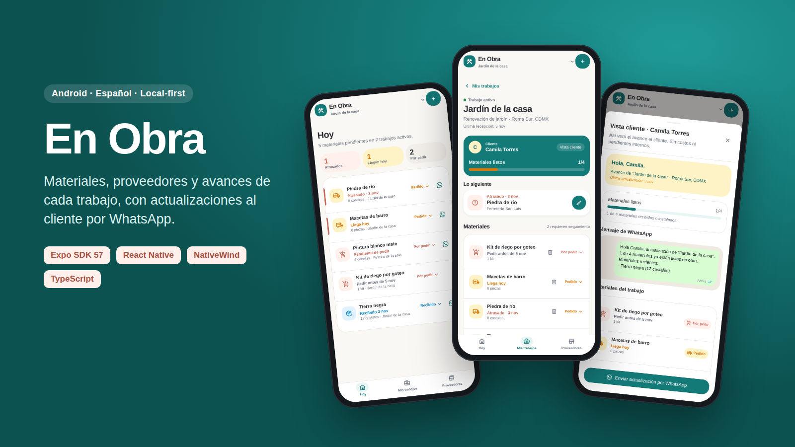
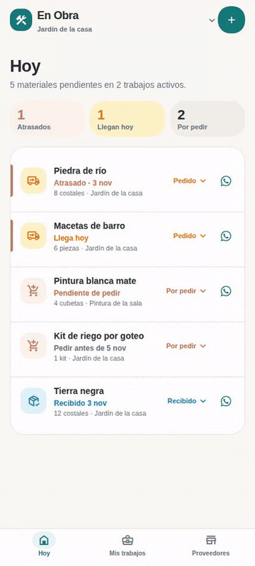
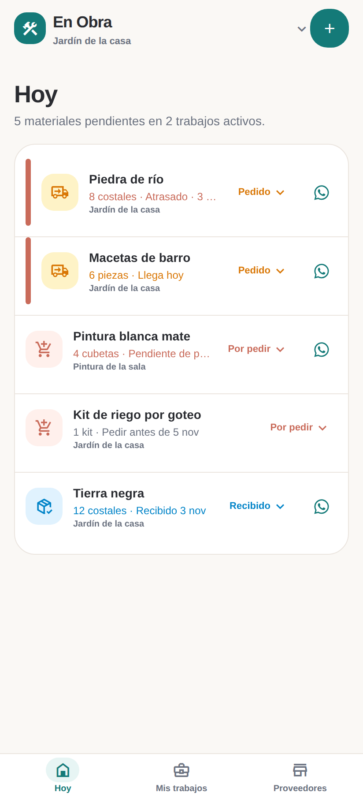
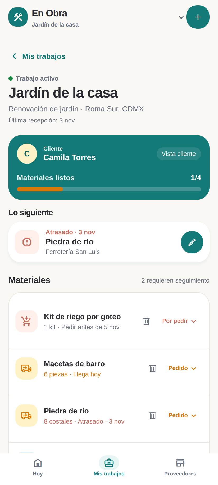
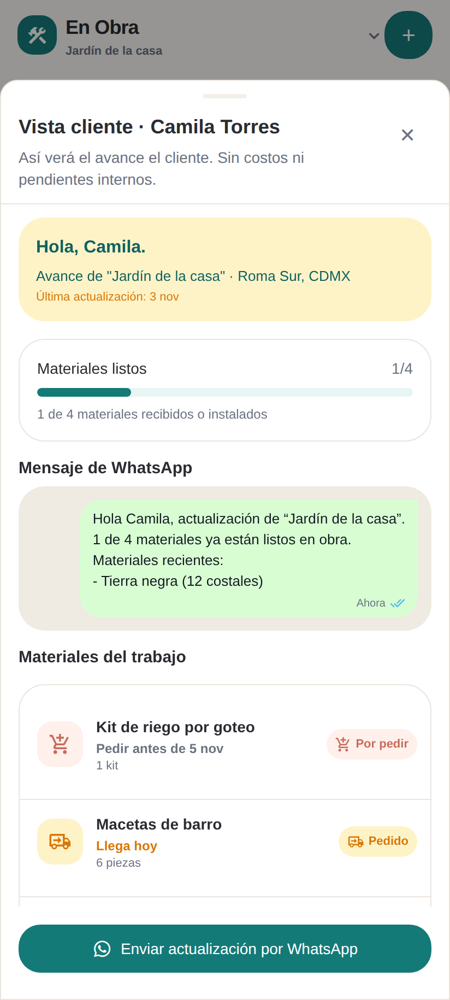
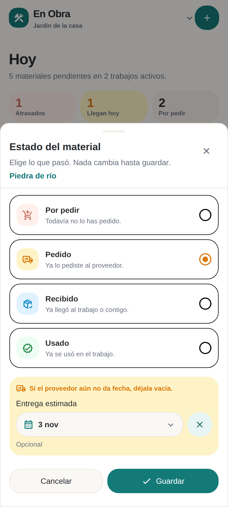
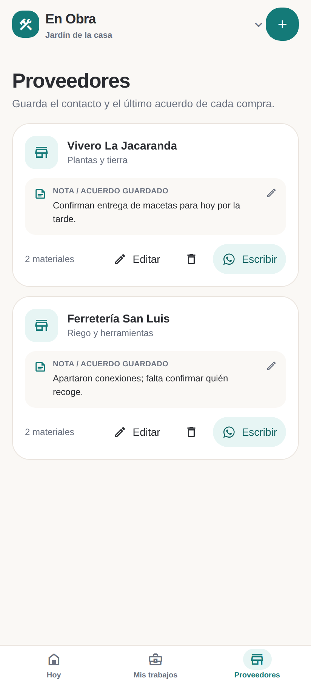
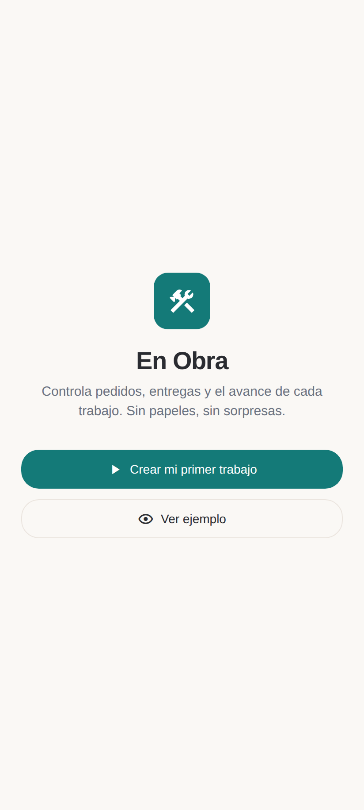
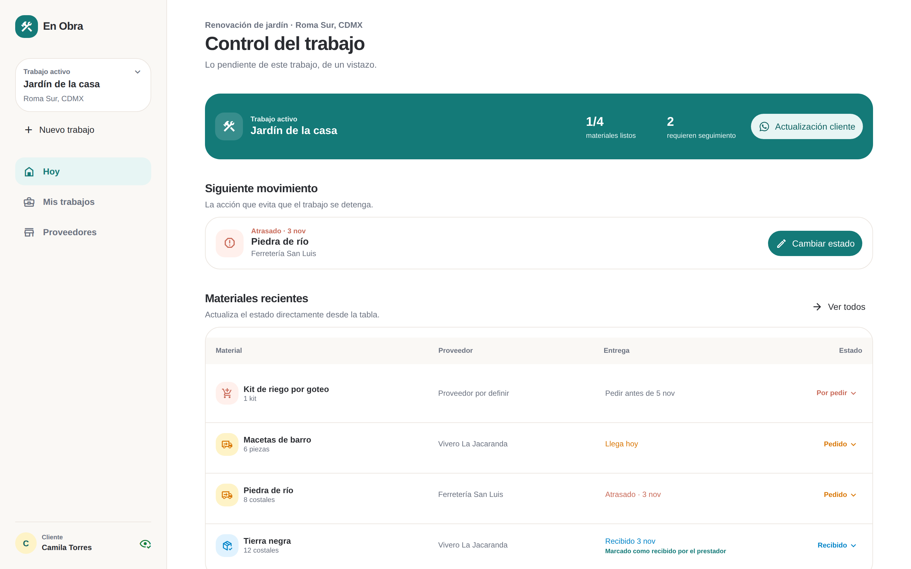

<p align="center">
  
</p>

<h1 align="center">En Obra</h1>

<p align="center">
  <em>Materiales, proveedores y avances de cada trabajo. Sin papeles, sin sorpresas.</em>
</p>

<p align="center">
  <a href="https://coystan.github.io/en-obra/?demo"><b>Try the live demo →</b></a>
  &nbsp;·&nbsp;
  <a href="https://github.com/CoyStan/en-obra/releases/latest"><b>Download the Android APK</b></a>
  <br><sub>The demo runs in your browser with sample data. Best on a phone, or a narrow window.</sub>
</p>

<p align="center">
  <a href="https://github.com/CoyStan/en-obra/actions/workflows/ci.yml"></a>
  
  
  
  <a href="LICENSE"></a>
</p>

En Obra is an Android app for one-person service businesses in Mexico: the
plumber, the electrician, the painter, the gardener. It answers the three
questions they get asked all day:

1. What material is missing, ordered, or already on site?
2. Which supplier did I order it from, and what did we agree?
3. How do I tell the client where the job stands without sharing my prices?

Everything stays on the phone. There's no account, no server and no sign-up.
Client and supplier updates go out through WhatsApp, because that's where these
conversations already happen.

The whole UI is in Spanish and phone numbers default to Mexican formats. The
same codebase runs on Android and in the browser, where it switches to a
desktop layout above 960 px. Expo should also build it for iOS, but I haven't
tested that.

> This is a portfolio project. It isn't in the Play Store and nobody is paying
> for it. The code, tests and design are real, and you're welcome to fork it.

## The core loop in 15 seconds

<p align="center">
  
</p>

The river stone arrives, so it gets marked *recibido*. The job's progress moves
from 1/4 to 2/4, and the client's WhatsApp message updates to match.

## Screenshots

<table>
  <tr>
    <td align="center"><br><sub><b>Hoy.</b> What's late, what arrives today, what to order.</sub></td>
    <td align="center"><br><sub><b>Trabajo.</b> One job, its client and materials.</sub></td>
    <td align="center"><br><sub><b>Vista cliente.</b> The exact WhatsApp message, no costs.</sub></td>
  </tr>
  <tr>
    <td align="center"><br><sub><b>Estado.</b> Por pedir, pedido, recibido, usado.</sub></td>
    <td align="center"><br><sub><b>Proveedores.</b> Contact and the last thing you agreed.</sub></td>
    <td align="center"><br><sub><b>Inicio.</b> Start a real job or open the demo.</sub></td>
  </tr>
</table>

<p align="center">
  <br>
  <sub>The same app on a wide screen switches to a sidebar and a materials table.</sub>
</p>

## What it does

- **Jobs.** Create one with a name and a client. Address, service type and
  phone are optional. Mark it finished or archive it when you're done.
- **Materials.** Each one moves through `por pedir → pedido → recibido → usado`.
  Give an ordered item a delivery date and the app flags it as *llega hoy* or
  *atrasado* when the day comes.
- **Suppliers.** Name, category, WhatsApp, and a note for the last agreement
  ("apartaron conexiones, falta confirmar quién recoge").
- **WhatsApp handoff.** One tap opens WhatsApp with a message already written.
  Suppliers get "¿Puedes confirmar entrega para 5 nov?". Clients get
  "3 de 5 materiales ya están listos en obra".
- **Client view.** Shows the WhatsApp message word for word before you send
  it. Prices, supplier notes and internal status never appear in it.
- **Demo mode.** "Ver ejemplo" (or `?demo` in the web URL) loads a sample
  garden and a paint job. Demo data lives under its own storage key and never
  mixes with yours.
- **Your data is safe on the device.** Saves go through a serialized write queue.
  The app shows "Guardado" only after the write succeeds. If stored data is
  corrupt, the app keeps a copy, locks editing and offers a JSON export
  instead of overwriting anything.

## Potential usage

Out of the box, En Obra fits anyone who buys material for someone else's job
and then has to explain where things stand:

| Who | A typical day in the app |
| --- | --- |
| Electrician | Orders 3 rolls of cable and a breaker panel from two hardware stores. When the panel's delivery date passes it jumps to the top as *atrasado*, and the client gets "2 de 4 materiales ya están listos en obra". |
| Plumber | Logs a water heater as *pedido* with Friday delivery, and messages the supplier to confirm without retyping the order. |
| Painter | Tracks buckets per room and shows the homeowner what's already on site before asking for the next payment. |
| Gardener | The demo scenario: soil, river stone, clay pots and a drip kit across two suppliers. |
| Small renovation crew | One phone, several active jobs, a single *Hoy* list of what's late across all of them. |
| Someone renovating their own home | The same flow, just with yourself as the client. |

It also works as a starting point for other projects:

- **A template for local-first Expo apps.** Versioned storage envelope,
  corruption recovery, write queue and a demo/user data split, in about
  300 lines with tests (`src/persistence`, `src/domain/en-obra/envelope.ts`).
- **A WhatsApp-first workflow pattern.** Many small businesses in Latin
  America run on WhatsApp. `src/domain/en-obra/whatsapp.ts` and `phone.ts`
  show how to build `wa.me` deep links with normalized E.164 numbers.
- **A base for features I deliberately left out.** Photos as delivery proof,
  cloud sync, a read-only client link, prices and deposits, or other
  countries' phone formats.

## Run it

You need Node 22 and npm.

```bash
git clone https://github.com/CoyStan/en-obra.git
cd en-obra
npm ci
npm run web        # opens in the browser; tap "Ver ejemplo"
```

On a phone, run `npm start` and scan the QR code with
[Expo Go](https://expo.dev/go). `npm run android` launches it on an emulator.

To install it on an Android phone, download the APK from the
[latest release](https://github.com/CoyStan/en-obra/releases/latest). It's
signed with a debug key, so Android will ask you to allow the install. GitHub
Actions builds it whenever a version tag like `v0.1.0` is pushed. If you have
an Expo account, `npm run build:android:apk` builds one with EAS instead.

## Project layout

```text
App.tsx                         entry point
src/
  screens/TrackerScreen.tsx     state, handlers, phone vs. desktop layout
  screens/tracker/              Hoy, Mis trabajos, job detail, Proveedores, welcome
  components/tracker/           material row, sheets, header, tab bar, snackbars
  components/tracker/desktop/   wide-screen sidebar, overview and tables
  components/reusables/         buttons, cards, inputs, sheets (NativeWind)
  domain/en-obra/               pure logic: types, status rules, phone, WhatsApp, demo data
  persistence/                  AsyncStorage repository, envelope, write queue
  tracker/                      store hook and presentation helpers
  theme/tokens.json             design tokens shared by Tailwind and RN styles
e2e/                            Playwright UI tests against the web build
maestro/en-obra-smoke.yaml      smoke flow for a real device or emulator
scripts/screenshots.mjs         regenerates every image and the GIF in this README
```

The domain layer has no React imports, so its tests run in plain Node without
a simulator. `TrackerScreen.tsx` owns state and navigation, and every screen
and sheet is its own component that takes data and callbacks as props.

## Checks

```bash
npm run typecheck   # tsc, strict
npm run lint        # oxlint
npm test            # vitest: domain and persistence
npm run verify      # all of the above plus expo-doctor
npm run build:web && npm run test:e2e   # Playwright UI tests on a phone viewport
npm run screenshots # rebuild docs/screenshots and the GIF from the web build
```

The UI tests open the demo, check that late items sort first, change a status
and watch the job progress update, preview the client message, undo a delete,
and create a job that has to survive a page reload.

CI runs all of it on every push and pull request. Each push to `main` also
deploys the web build to GitHub Pages, which is the live demo above, and each
version tag builds the APK for the release page.

## Tech

[Expo](https://expo.dev) SDK 57, React Native 0.86, React 19,
[NativeWind](https://www.nativewind.dev) 4 on Tailwind 3, AsyncStorage,
TypeScript in strict mode, Vitest, oxlint, Playwright for UI tests and
screenshots, Maestro for on-device smoke tests, and GitHub Pages for the demo.

## License

[MIT](LICENSE) © CoyStan
